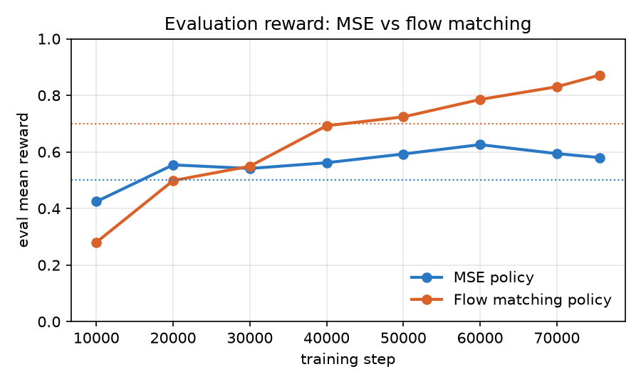
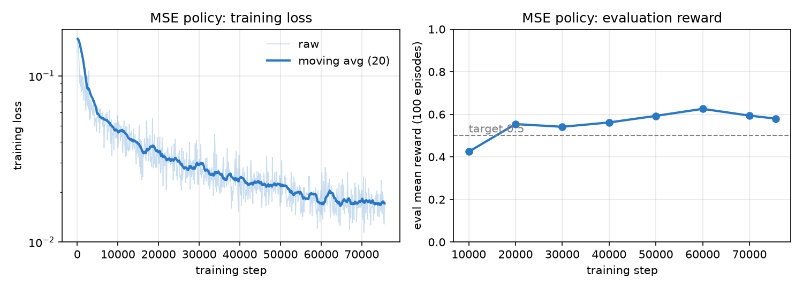
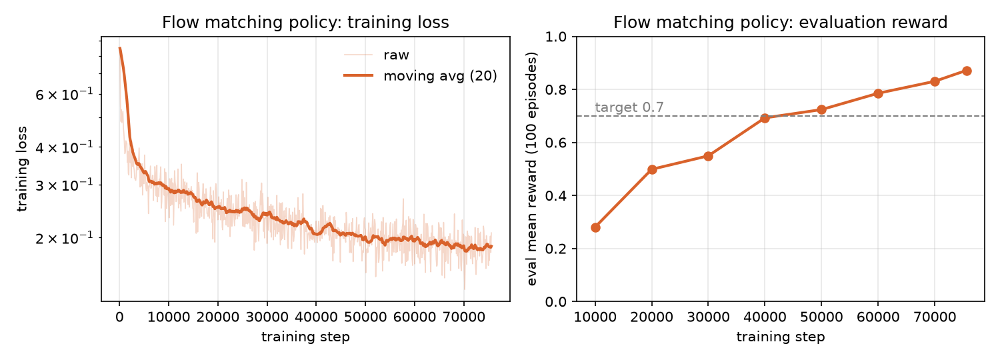
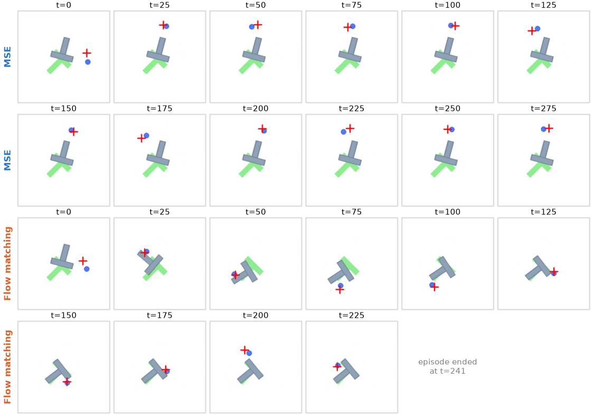
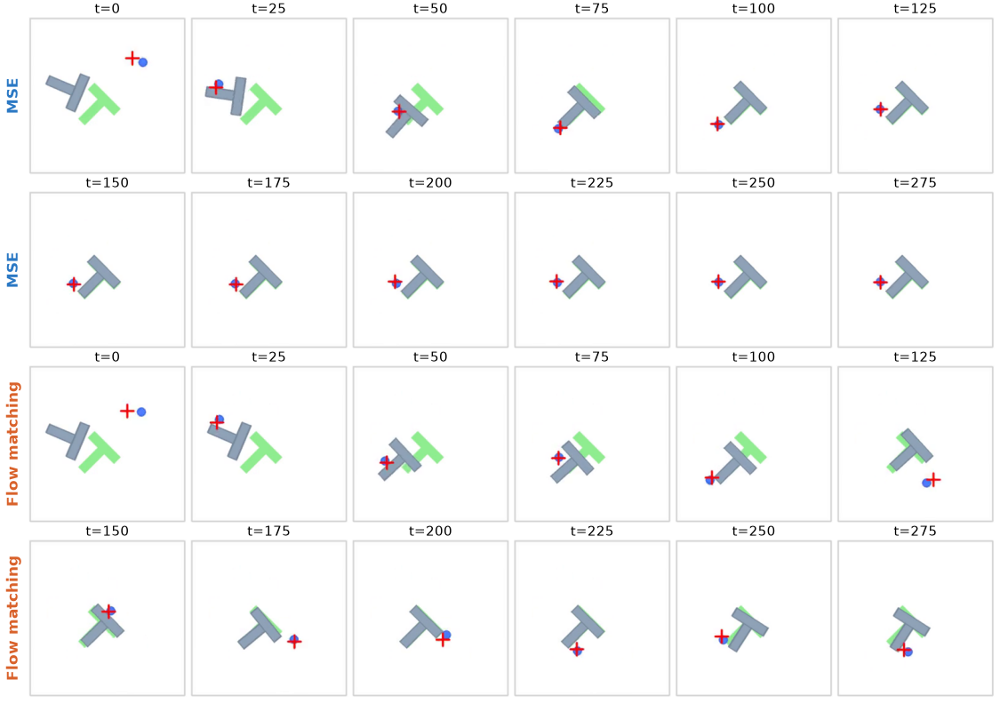
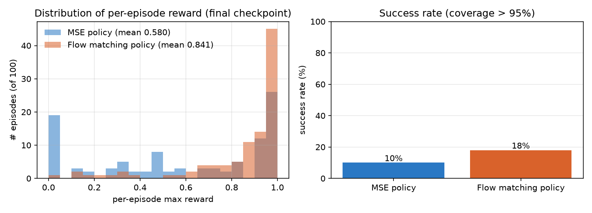
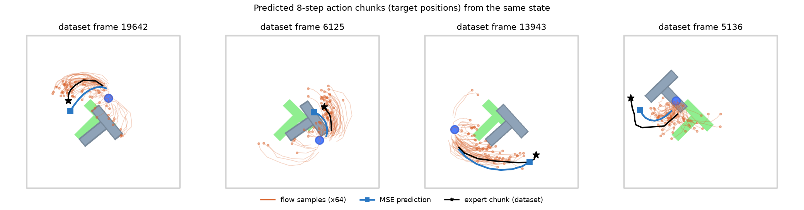

# HW1 Report: Action-Chunking Imitation Learning on Push-T (MSE vs. Flow Matching)

> CS285 Spring 2026 · Assignment 1
> Implementation: [`src/hw1_imitation/model.py`](../src/hw1_imitation/model.py), [`src/hw1_imitation/train.py`](../src/hw1_imitation/train.py)
> Reproduce figures: `uv run --with matplotlib python report/make_figures.py --mse-dir exp/<mse_run> --flow-dir exp/<flow_run>`

## Summary of Results

| Policy | Target | Best eval reward during training | Final eval reward (75.6k steps) | Success rate (coverage > 95%) |
|---|---|---|---|---|
| MSE | ≥ 0.5 | 0.626 (60k steps) | **0.580** ✅ | 10% |
| Flow Matching | ≥ 0.7 | 0.872 (75.6k steps) | **0.872** ✅ | 18% |

Eval reward is the mean, over 100 episodes (`seed = 0..99`), of the per-episode maximum reward. Success rates come from a separate re-evaluation of the final checkpoints. The MSE policy is deterministic, so the re-evaluation reproduces the logged reward exactly (0.580). The flow policy samples noise at every query, so its re-evaluation gives 0.841, which is within sampling noise of the logged 0.872.

---

## 1. Experimental Setup

**Environment and data.** The Push-T state is 5-dimensional, `(agent_x, agent_y, block_x, block_y, block_angle)`, and the action is the 2-D target position of the agent. The expert data is the official Diffusion Policy dataset: 206 demonstrations, about 24k `(state, action chunk)` samples. States and actions are z-score normalized per dimension, and both models are trained and queried entirely in normalized space.

**Action chunking.** Chunk length is K = 8. Each policy query returns 8 actions, which are executed open-loop before the policy is queried again on the latest observation.

**Network architecture (MLP, shared by both policies)**

| | MSE policy | Flow matching policy |
|---|---|---|
| Input | state (5) | state (5) + flattened noisy chunk A_τ (16) + time τ (1) = **22** |
| Hidden layers | 3 × 256, ReLU | 3 × 256, ReLU |
| Output | 16 → reshaped to an (8, 2) action chunk | 16 → reshaped to an (8, 2) **velocity field** |
| Output activation | none (linear) | none (linear) |
| Parameters | 137,232 | 141,584 |

**Training hyperparameters (identical for both; starter-code defaults).** Adam, lr = 3e-4, no weight decay, batch size 128, 400 epochs (about 75.6k steps), seed 42. Evaluation runs every 10k steps and once more at the end of training. Each run took about 15 minutes on a single RTX 5090; most of that time is spent in environment simulation on the CPU during evaluation.

---

## 2. MSE Policy

**Objective.** A single forward pass predicts the whole action chunk, which is regressed onto the expert chunk with `F.mse_loss`. This differs from Eq. (1) only by the constant factor `1/(K·2)`, which is equivalent to rescaling the learning rate.

**Observations:**

- The loss keeps falling on a log scale (0.17 → 0.017), but the reward plateaus at **0.55–0.63** after 20k steps. It peaks at 0.626 at 60k steps and then dips slightly. **Lower training loss does not produce a better policy here.** MSE regression fits the conditional mean, so a lower loss only means the mean is estimated more precisely; the mean action itself is not a good action (see Section 4).
- The per-episode rewards are strongly bimodal (see the histogram in Section 4): about 26 episodes are close to a perfect score, but **19 episodes score almost exactly 0**, meaning the T block was essentially never pushed into the goal region.

## 3. Flow Matching Policy

**Objective.** For each sample we draw noise $A_0\sim\mathcal N(0,I)$ and a time $\tau\sim U(0,1)$, form the interpolation $A_\tau=\tau A+(1-\tau)A_0$, and regress the network output onto the velocity $A-A_0$. At inference time we start from pure noise and integrate with 10 Euler steps. τ is explicitly concatenated to the network input; without it the network cannot tell which stage of denoising it is at.

**Observations:**

- **The loss drops quickly from 0.85 to about 0.3 in the first ~5k steps, then decreases only slowly to about 0.19, staying near a fairly high plateau. The reward, however, rises steadily** from 0.28 to 0.87 and has not saturated by the end of training. Late in training, small decreases in loss correspond to large improvements in policy quality.
- The flow matching target $A-A_0$ contains random noise, so the loss has an irreducible floor: the same $(o, A_\tau, \tau)$ can correspond to different values of $A-A_0$. The absolute loss value therefore says little about policy quality, and the policy has to be judged by rollout reward.
- **Early in training it learns more slowly than MSE**: 0.28 vs. 0.42 at 10k steps, and 0.50 vs. 0.55 at 20k steps. Learning a full distribution is harder than learning a mean. **After 30k steps it overtakes MSE and the gap keeps growing.** It reaches 0.693 at 40k steps and 0.724 at 50k steps, which clears the 0.7 target.
- Since the curve has not saturated, longer training or a larger network would likely improve it further.

## 4. Comparing MSE and Flow Matching Behavior

### 4.1 Rollout videos (final checkpoints; one frame every 25 steps)

Blue disk: agent; red cross: commanded target position; gray: T block; green: goal region.

#### Episode 0: MSE hesitates between two ways around the block; flow pushes decisively and succeeds

The MSE agent (blue dot) moves above the T block and then makes small back-and-forth movements on either side of the T's stem. For all 300 steps it never really makes contact with the block or pushes it, and the episode reward is close to 0. The flow policy is already in contact and pushing by the second frame. It keeps adjusting with a "push, move around to the other side, push again" pattern, and at step 241 coverage exceeds 95%, so the episode terminates early as a success.

#### Episode 2: both bring the T close to the goal, but finish differently

MSE pushes the T close to the goal within the first 100 steps and then **stops moving**. It stays nearly still for the remaining ~200 steps and never completes the final fine alignment. Flow keeps circling the block and making small pushes to correct its angle. It is more active, but it occasionally **over-corrects**: at the end of this episode it nudges an already well-aligned T slightly out of place.

### 4.2 Qualitative summary

| | MSE policy | Flow matching policy |
|---|---|---|
| Decision style | Hesitant. In the same state the expert has several reasonable actions (go around the left or the right, push this side or that side). MSE outputs their average and often gets stuck between choices | Decisive. Each sample lands on one expert mode, which the policy then commits to |
| Typical failure | Dithers or stalls next to the T without ever touching it; or "freezes" once the T is close to the goal | Occasionally over-corrects and pushes a nearly finished T out of place; occasionally takes a long detour |
| Action magnitude | Smaller and more conservative; averaging shrinks large actions toward the middle | Similar to the expert; detours and pushes are carried out fully |
| Cost per query | 1 forward pass | 10 forward passes (10 Euler steps) |

### 4.3 Quantitative support: per-episode reward distribution

- **44%** of MSE episodes have reward < 0.5, with a clear spike near 0 (19 episodes). This matches the "hesitates next to the T and never pushes it" failure mode above. Only **9%** of flow episodes score below 0.5.
- Flow rewards are concentrated in 0.9–1.0, with a median of 0.93; the MSE median is 0.68.
- Strict success rates (coverage > 95%) are low for both: 10% for MSE and 18% for flow. Both policies have learned to push the T roughly into place, but the last few percent of precise alignment remain hard. Mean reward measures coverage, so a reward of 0.87 does not mean an 87% success rate.

### 4.4 Visualizing multimodality directly

For the same state, the figure shows 64 flow samples (orange), the single MSE prediction (blue), and the chunk the expert actually executed in the dataset (black). Each curve connects the 8 target positions of a chunk, and the blue disk is the agent's current position. The 4 states were picked automatically from 2000 random dataset states, using the criterion "the flow samples are spread out and the MSE prediction is far from every flow sample."

- **Column 1 (frame 19642) is the clearest example.** The flow samples split into two clusters: one goes over the top of the T to the left, the other goes down and to the right around the other side. The expert took the upper-left route. **The MSE prediction lies between the two clusters**, an "average" route that belongs to neither. This is exactly why the MSE policy hesitates and dithers in rollouts.
- **Column 2 (frame 6125).** The main flow cluster moves up along the right side of the T, and a few samples go around to the lower left. The MSE prediction is shorter than both and sits between them.
- **Column 4 (frame 5136).** The expert executes a long detour, first down and then to the left. The MSE trajectory points in roughly the right direction, but its **magnitude is clearly shrunk**, a typical effect of regressing to the mean. The flow samples cover a whole region, from small in-place adjustments to detours away from the block.

## 5. Conclusions

1. Both policies meet the assignment targets: MSE 0.58 ≥ 0.5 and flow 0.87 ≥ 0.7.
2. The MSE policy is limited not by underfitting but by **the expressiveness of its model class**. It can only represent the conditional mean, so on multimodal expert data it produces "average" actions, which show up as hesitation and undersized motions. The loss keeps falling while the reward stalls around 0.6.
3. Flow matching represents the entire action distribution as a velocity field from noise to actions. Each sample lands on one concrete mode, which shows up as decisive, complete pushing motions. Its reward is about 0.3 higher and it has far fewer failed episodes. The costs are 9 extra forward passes per query and slower convergence early in training.
4. For flow matching, the training loss has a noise floor and is not a usable measure of policy quality; the policy must be evaluated with environment rollouts.

## Appendix: Files

| Path | Contents |
|---|---|
| `report/make_figures.py` | Generates every figure in this report: training curves from `log.csv`, re-evaluation of the final checkpoints, and the multimodality visualization |
| `report/build_pdf.py` | Renders this README into `report/hw1_report.pdf` (`uv run --with markdown python report/build_pdf.py`) |
| `report/figures/summary.json` | Per-episode statistics for the final checkpoints |
| `exp/` (ignored by `.gitignore`) | Raw experiment logs: `log.csv`, wandb files, checkpoints |
